<a href="https://dev-kamrul-hasan.netlify.app/">
<picture>
  <source media="(prefers-color-scheme: dark)" srcset="./banner-dark.svg">
  
</picture>
</a>

<samp>
<a href="https://dev-kamrul-hasan.netlify.app/">portfolio</a> ·
<a href="https://dev-kamrul-hasan.netlify.app/#work">case studies</a> ·
<a href="https://www.linkedin.com/in/muhammed-kamrul-hasan/">linkedin</a>
</samp>

Senior full-stack engineer in Dhaka, Bangladesh. I build multi-tenant SaaS, payment systems, realtime communication and mobile apps, and I usually own them end to end, from architecture to production.

I work AI-assisted with Claude Code: a spec and an approved plan before any code, tests on every change, and a security audit before launch.

Currently building **NimbleLine**, an AI cloud call centre, at Luminous Labs. My client and company work lives in private repositories, so the write-ups are on my site.

### Selected work

<table>
<tr>
<td width="50%" valign="top">

 <b><a href="https://dev-kamrul-hasan.netlify.app/work/nimbleline/">NimbleLine</a></b> · AI cloud call centre for any CRM
 Node.js · Fastify · PostgreSQL · FreeSWITCH
</td>
<td width="50%" valign="top">

 <b><a href="https://dev-kamrul-hasan.netlify.app/work/cartifly/">Cartifly</a></b> · Multi-store e-commerce SaaS, built solo
 Laravel · React · PostgreSQL · Docker
</td>
</tr>
<tr>
<td width="50%" valign="top">

 <b><a href="https://dev-kamrul-hasan.netlify.app/work/exolog/">Exolog</a></b> · Multi-tenant website platform, live since 2007
 Laravel · Vue 3 · MySQL
</td>
<td width="50%" valign="top">

 <b><a href="https://dev-kamrul-hasan.netlify.app/work/leadsnimble/">LeadsNimble</a></b> · Messaging CRM, Flutter app on Google Play
 Laravel · React · Flutter · Go
</td>
</tr>
</table>
